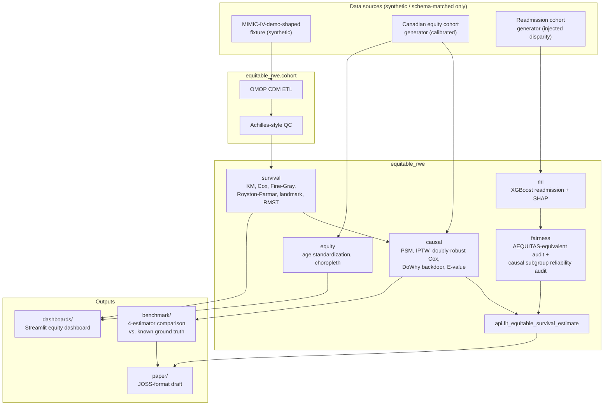

# PrivacyGenomic

**Real-World Evidence, Health Equity & Causal Outcomes Analytics Platform**

[](https://github.com/NosakhareOsaro/privacygenomic/actions/workflows/ci.yml)


An open, reproducible pipeline that turns OMOP-CDM-formatted EHR data into
causally valid, fairness-audited clinical outcome estimates and health-equity
intelligence — built for Canadian health systems (CIHI/Statistics
Canada-aligned) and PhysioNet-derived cohorts. No real patient data is used
anywhere in this repository; see
[Data governance](#data-governance) below.

> The coverage badge reflects the last locally verified test run
> (`uv run pytest`, 96.87%, floor enforced at 85%), not a live Codecov
> integration — see [What's left to do manually](#whats-left-to-do-manually).
> The DOI badge will become real once this repository's first GitHub release
> is linked to Zenodo (see the same section).

## Why this exists

Most public causal-inference or health-equity portfolio projects stop at
"here is one adjusted estimate." This one is built around three things that
are usually missing:

1. **A single API that returns a causal estimate *and* a fairness report
   together**, not two disconnected tools —
   [`fit_equitable_survival_estimate`](#quickstart) combines a doubly-robust
   IPTW-adjusted Cox estimator with a per-subgroup evidence-reliability
   audit in one call.
2. **A benchmark against a known answer.** The
   [four-estimator causal-adjustment benchmark](#results) compares naive
   Cox, propensity score matching, IPTW, and DoWhy backdoor adjustment on a
   cohort with an *exact*, synthetically-known ground-truth hazard ratio —
   so the results below say which adjustment strategy actually recovered
   the truth, not just that adjustment happened.
3. **Methods most tutorials skip.** A from-scratch Fine-Gray competing-risks
   implementation (no mainstream Python survival library ships one), a
   Royston-Parmar-family flexible parametric model, E-value sensitivity
   analysis for unmeasured confounding, and DoWhy's automated refutation
   battery — all wired into the pipeline, not left as an exercise.

Every non-obvious design trade-off behind these choices is written down as
an Architecture Decision Record in [docs/architecture](docs/architecture),
including the times a design turned out to need a second look — a real bug
the test suite caught (a date-shift-unaware plausibility check), a
correctness validation performed by hand (Fine-Gray reduces to a plain Cox
fit to 7 significant figures when there are no competing events), and a
performance rewrite (Fine-Gray's naive construction took ~40s at n=1,500;
vectorized, ~5s at n=4,000).

## Architecture



## Installation

This project targets Python 3.11–3.12 and uses [uv](https://docs.astral.sh/uv/)
for environment management.

```bash
uv sync --extra dev
```

## Quickstart

```python
from equitable_rwe import fit_equitable_survival_estimate

result = fit_equitable_survival_estimate(
    df,
    duration_col="time_to_event_days",
    event_col="event_observed",
    treatment_col="treat",
    covariates=["age", "comorbidity_score"],
    subgroup_col="remoteness_level",
)

result.hazard_ratio                       # the causal estimate
result.causal_estimate.ci_lower, result.causal_estimate.ci_upper
result.is_equitable                       # adequate evidence for every subgroup?
result.fairness_report.per_subgroup       # per-subgroup HR, effective N, covariate balance
```

Try it against the synthetic cohorts already committed to this repository:
`data/synthetic/equity_cohort.parquet` (health-equity survival cohort) and
`data/synthetic/readmission_cohort.parquet` (30-day readmission, with an
injected demographic disparity used to test the fairness auditor itself).

## Results

The [four-estimator benchmark](benchmark/) simulates a cohort with an
**exact, known** treatment hazard ratio of **0.65** (protective) under
confounding by indication, then checks which adjustment strategy recovers
it:

| Estimator | Measure | Estimate | 95% CI | True value | E-value (point) |
|---|---|---|---|---|---|
| Naive (unadjusted) Cox | hazard ratio | 0.491 | (0.452, 0.534) | 0.650 | 3.49 |
| Propensity score matching | hazard ratio | 0.754 | (0.670, 0.849) | 0.650 | 1.98 |
| IPTW | hazard ratio | 0.730 | (0.665, 0.802) | 0.650 | 2.08 |
| DoWhy backdoor adjustment | risk ratio @ 365d | 0.613 | — | 0.782 | 2.64 |

**In plain language:** the unadjusted comparison overstates the
treatment's benefit by a wide margin (hazard ratio 0.49 vs. the true
0.65) — exactly the confounding-by-indication bias the simulation was
built to produce. Propensity matching and IPTW each cut that error
roughly in half or more, landing on either side of the true value rather
than systematically toward or away from it. The E-value column asks a
different question for every estimator: how strong would an unmeasured
confounder's association with *both* treatment and outcome need to be to
fully explain away that estimate? Values around 2–3.5 here mean a
moderately strong hidden confounder could matter — a robustness signal
this project surfaces for every causal estimate it produces, not just
this one benchmark. See
[benchmark/results/benchmark_summary.md](benchmark/results/benchmark_summary.md)
for the full table (confidence intervals, log-scale bias, DoWhy's
refutation results) and exactly how each number was produced — every
figure above comes from `benchmark/run_benchmark.py`, not by hand.

## Repository structure

```
src/equitable_rwe/   the installable package: cohort, survival, causal, fairness, ml, equity, api
data/synthetic/      generators + committed synthetic data (no real patient data — see below)
benchmark/           the 4-estimator causal-adjustment benchmark + committed results
dashboards/          open-source Streamlit health-equity dashboard
docs/                architecture decision records, data governance, PR notes, Sphinx site source
paper/               JOSS-format paper draft
tests/               pytest suite mirroring src/, 97% coverage
```

## Documentation

- **API reference**: build locally with `uv run sphinx-build -b html docs/source docs/_build/html`
  (see [docs/README.md](docs/README.md)); will be published to ReadTheDocs
  once imported there (see [What's left to do manually](#whats-left-to-do-manually)).
- **Architecture decisions**: [docs/architecture](docs/architecture) — five
  ADRs covering the OMOP ETL, survival model choices, causal model
  choices, fairness/ML choices, and the equity dashboard's choices, each
  stating what was considered and rejected, and why.
- **Data governance**: [docs/data-governance/ocap-and-privacy.md](docs/data-governance/ocap-and-privacy.md).

## Data governance

Every dataset in this repository is either a small, deterministically
generated fixture matching a public schema (no real data), or a synthetic
cohort calibrated against *public, aggregate* statistics — never real
patient data, and never real Indigenous-identity data. See
[docs/data-governance/ocap-and-privacy.md](docs/data-governance/ocap-and-privacy.md)
for the OCAP® principles behind that decision and exactly what it means in
practice throughout this codebase.

## Demo

A short screen recording of the Streamlit dashboard belongs here. To add
one:

```bash
uv run streamlit run dashboards/equity_dashboard.py
```

Record the browser window (e.g. `Cmd+Shift+5` on macOS, or
[Peek](https://github.com/phw/peek) / [ScreenToGif](https://www.screentogif.com/)
on Linux/Windows), save as `docs/assets/demo.gif`, and embed it here:

```markdown

```

## Development

```bash
uv sync --extra dev
uv run pre-commit install

uv run ruff check src tests data benchmark dashboards docs/source
uv run black --check src tests data benchmark dashboards docs/source
uv run mypy src
uv run pytest
```

See [CONTRIBUTING.md](CONTRIBUTING.md) for the full workflow.

## What's left to do manually

These require accounts and access this environment does not have:

- **PhysioNet credentials**: the OMOP ETL (`equitable_rwe.cohort`) is
  written to run unmodified against the real MIMIC-IV Clinical Database
  Demo or full MIMIC-IV — point `load_mimic_tables` at the real directory
  once you have credentialed access. It has not been run against real
  MIMIC-IV data in this repository (see
  [adr-0001](docs/architecture/adr-0001-omop-etl.md)).
- **GitHub repository creation + push**: this repository has been built
  and committed locally only; push it to your own GitHub account when
  ready.
- **Zenodo linking**: once pushed, connect the repository at
  [zenodo.org](https://zenodo.org) and cut a GitHub release — `.zenodo.json`
  is already in place to populate the deposit metadata, which will mint a
  real DOI to replace the placeholder badge above.
- **ReadTheDocs import**: import the repository at
  [readthedocs.org](https://readthedocs.org) — `.readthedocs.yaml` is
  already configured.
- **JOSS submission**: `paper/paper.md` is a draft in the correct format
  but has not been submitted; see [paper/README.md](paper/README.md) for
  what's left (PDF rendering via JOSS's own tooling, then the actual
  submission).
- **Codecov (optional)**: CI already uploads coverage as a build artifact;
  wiring it to Codecov for a live coverage badge requires a Codecov
  account.

## License

MIT — see [LICENSE](LICENSE).

## Citation

See [CITATION.cff](CITATION.cff) and the JOSS-format draft at
[paper/paper.md](paper/paper.md).
